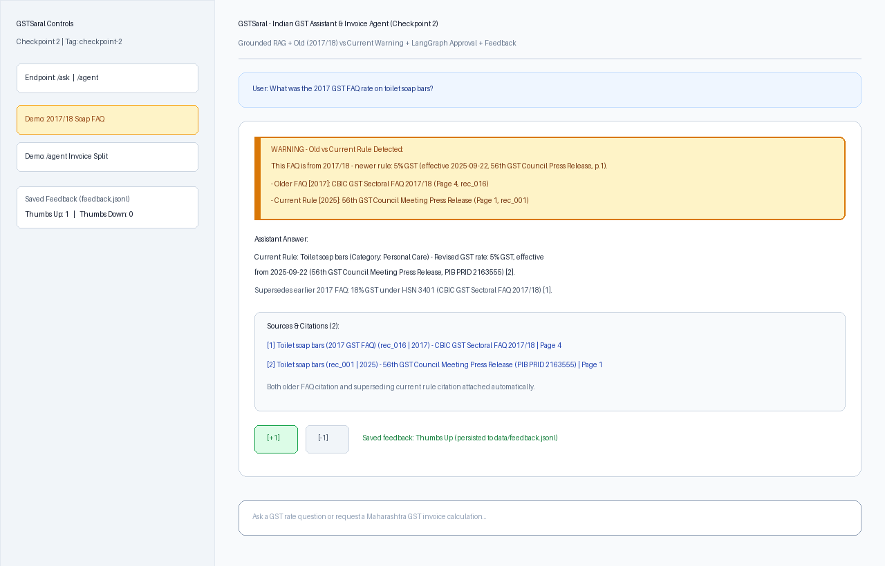

# Day 10 — Streamlit Chat UI (`ui/app.py`), Old-vs-Current Warning & Checkpoint 2 (`checkpoint-2`)

## UI Screenshot (Old vs Current Rule Warning + Dual Citations + Thumbs Up/Down)


## Folder Structure
```text
day10/
├── README.md
├── requirements.txt
├── .gitignore
├── ui/
│   └── app.py           # Streamlit chat UI calling /ask or /agent, citations, thumbs up/down, Old vs Current warning
├── app/
│   ├── __init__.py
│   ├── chunking.py      # Preserves source, page, title, topic_key & rule_year
│   ├── rag.py           # Hybrid RAG + Old vs Current superseding-rule detector + "I don't know" abstention
│   ├── tools.py         # gst_invoice_calculator (CGST+SGST / IGST + inclusive back-calc) & rag_search_tool
│   ├── agent_loop.py    # Hand-written Thought -> Action -> Observation agent loop
│   ├── graph.py         # LangGraph StateGraph with MemorySaver + 1 human approval interrupt() gate
│   └── main.py          # FastAPI backend exposing /ask, /agent, /feedback, and /health
├── data/
│   └── records.json     # 20 GSTSaral records (15 current 2019–2025 rules + 5 paired 2017/18 historical FAQs)
└── docs/
    └── streamlit_checkpoint2_demo.png
```

## Signature Feature: `Old vs Current` Rule Warning
- Whenever a retrieved FAQ chunk (`rule_year` in `2017`/`2018`, e.g. `CBIC GST Sectoral FAQ 2017/18`) is older than a superseding rule on the same `topic_key` (`56th GST Council Meeting Press Release`, effective `2025-09-22`), the Streamlit UI renders a high-visibility **yellow warning banner**:
  > `⚠️ Old vs Current Rule Warning: This FAQ is from 2017/18 — newer rule: 5% GST (effective 2025-09-22, 56th GST Council Meeting Press Release (PIB PRID 2163555), p.1).`
- Both the **older FAQ citation** (`[1]`) and the **current superseding rule citation** (`[2]`) are surfaced in the warning banner and in the expandable **Sources & Citations** panel.

## Checkpoint 2 Live Demo & Git Tag (`checkpoint-2`)
```powershell
# 1. Install dependencies
pip install -r requirements.txt

# 2. Start FastAPI backend (Terminal 1)
uvicorn app.main:app --reload --port 8000

# 3. Start Streamlit Chat UI (Terminal 2)
streamlit run ui\app.py

# 4. Tag Checkpoint 2 in Git
git add .
git commit -m "Checkpoint 2: Streamlit UI with Old vs Current warning, citations, feedback, and /agent approval"
git tag -a checkpoint-2 -m "Checkpoint 2 Live Demo"
git push origin main --tags
```
