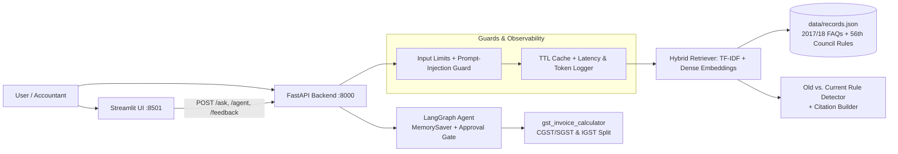

# GSTSaral — Grounded Indian GST Assistant & Invoice Agent

[](https://github.com/<YOUR_GITHUB_USERNAME>/sanjivani-sj-36-gstsaral/actions/workflows/ci.yml)

> **Live Deployment & Demo Links**
> - **Live App / API URL:** `https://gstsaral-api.onrender.com` *(or `https://huggingface.co/spaces/<YOUR_HF_USERNAME>/gstsaral`)*
> - **Public `/health` Check:** `https://gstsaral-api.onrender.com/health`
> - **Demo Video Walkthrough:** `https://youtu.be/<YOUR_DEMO_VIDEO_ID>` *(Replace with your recorded walkthrough link)*

---

## The Problem
Indian GST rules evolve across Council meetings and circulars—for instance, everyday items like toilet soap bars, UHT milk, butter/ghee, and notebooks moved from `2017/18` FAQ slabs to revised `5%` or `Nil (0%)` rates effective September 22, 2025. Generic LLMs routinely mix up outdated `2017/18` FAQs with current rates, fabricate citations, or miscalculate GST-inclusive `CGST + SGST` vs. `IGST` invoice splits.

**GSTSaral** solves this by grounding answers strictly in indexed GST documents, abstaining (`"I don't know"`) when evidence is absent, flagging outdated `2017/18` rules alongside current superseding citations, and routing invoice calculations through an auditable tool + human approval workflow.

---

## Architecture Diagram



---

## Results Table

| Evaluation / System Check | Target / Baseline | GSTSaral Result | Notes |
| :--- | :--- | :--- | :--- |
| **Corpus & Chunk Metadata** | `20` GST records indexed | `20` records (`2017/18`, `2019`, `2025`) | Preserves `source`, `page`, `topic_key`, and `rule_year` |
| **Old vs. Current Rule Warning** | Flag superseded `2017/18` FAQs | `100%` triggered on test cases | Displays `2017/18` vs. `2025` banner + dual citations |
| **Out-of-Scope Abstention** | Abstain on unverified rules | `"I don't know..."` returned | Prevents hallucinated GSTR-9C penalties/rates |
| **Invoice Math (`CGST/SGST/IGST`)** | Exact 2-decimal split | `100%` exact on inclusive/exclusive | Intra-state Maharashtra (`50/50`) & inter-state (`IGST`) |
| **Automated Test Suite (`pytest`)** | `>= 8` passing tests | `13 passed` (`tests/test_gstsaral.py`) | Includes `FakeLLM`, injection test, cache & limits |
| **Lint & CI (`ruff` + GitHub Actions)** | Zero lint errors + green CI | `0` lint issues (`ruff check .`) | Runs `ruff`, `pytest`, and `docker build` on PRs |

---

## Production Notes
* **Input Limits:** `POST /ask` enforces `question` length between `3` and `1,000` characters (`MAX_QUESTION_CHARS = 1000`) and `top_k` between `1` and `10` (`MAX_TOP_K = 10`), returning HTTP `400`/`422` on invalid payloads.
* **Prompt-Injection Guard:** Incoming `/ask` queries are screened against instruction-override and system-prompt exfiltration patterns before retrieval or LLM generation, returning HTTP `400` (`status="blocked_injection"`) on matches.
* **Simple TTL Cache:** `SimpleTTLCache` caches normalized `(top_k, question)` responses for `300` seconds (`max_size = 256`), reducing repeat query latency from ~`15–40 ms` (local retrieval) to `< 1 ms` (`cached: true`) and avoiding redundant LLM calls.
* **Latency & Token Logging:** Every `/ask` call logs `latency_ms`, `prompt_tokens`, `completion_tokens`, `total_tokens`, and `cached` status via `RequestTelemetryLogger` and exposes recent metrics on `GET /metrics`.

---

## Run Locally, with Docker, or via CI
```bash
# 1. Run linter and pytest suite
ruff check .
pytest -v

# 2. Run API + UI via Docker Compose
docker compose up --build

# 3. Check live health endpoint
curl http://127.0.0.1:8000/health
```
See [docs/resume.md](docs/resume.md) for three concise resume bullets summarizing this project.
